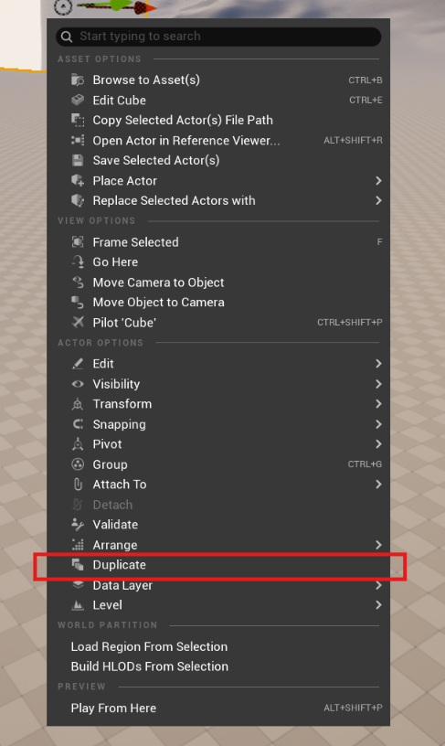
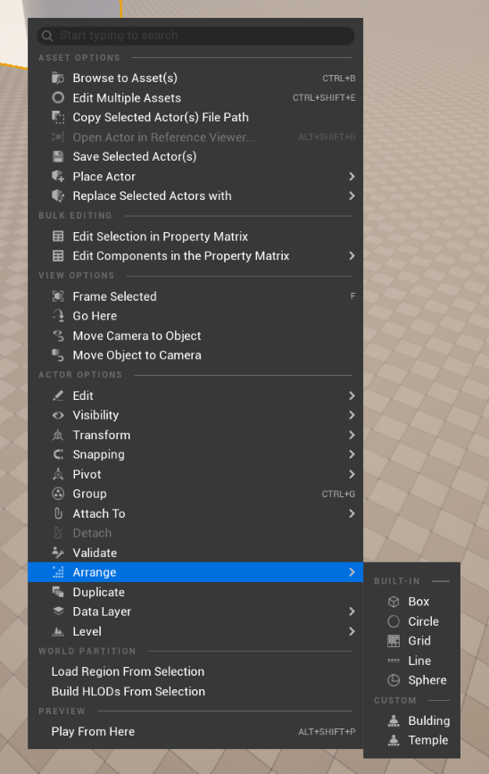
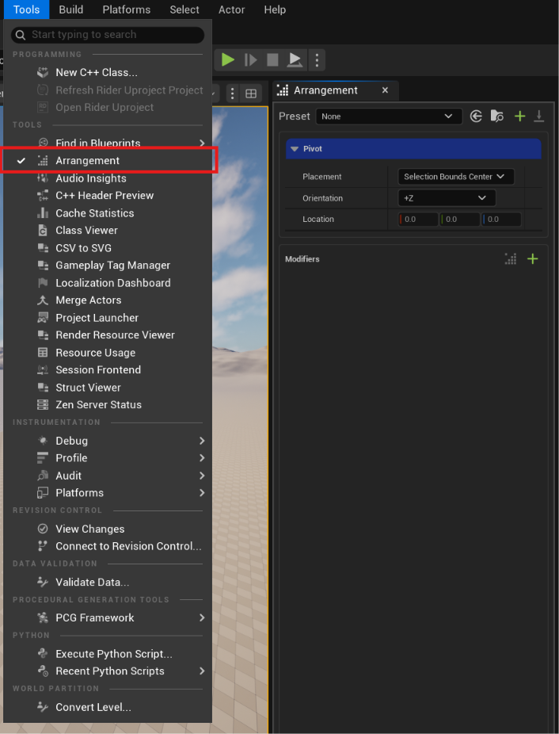
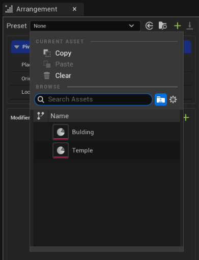
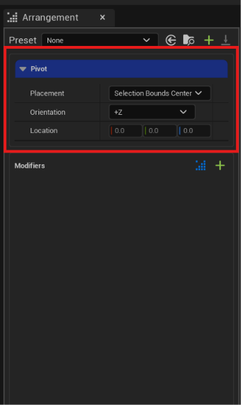
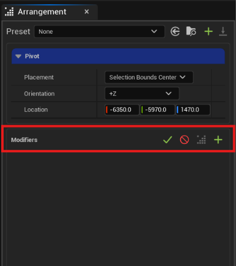
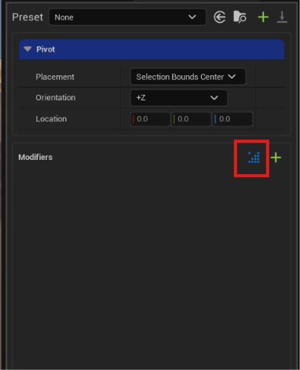
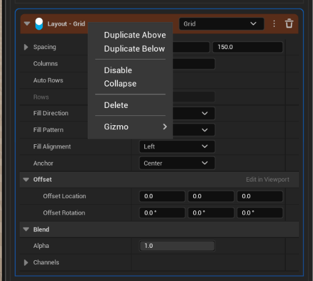

# UE5-ModularArrangementSystem

## Overview
Official documentation for the **Modular Arrangement System (MAS)** Unreal Engine plugin: setup, usage and extension.

This version comes with two tools:
- **Duplicate Tool** – duplicates selected actors with offsets, naming rules and Outliner folders.
- **Arrangement Tool** – arranges selected actors into layouts, previewed live in the viewport.

---

## Duplicate Tool
Duplicates the selected actors with extra options such as an offset, custom copy names, incremental suffixes and placing the copies into an Outliner folder.

**To open it:** select the actors you want to copy, right-click in the viewport or the Outliner to open the actor context menu, then choose **Duplicate** near the bottom.



### Settings
| Setting | Description |
|---|---|
| **Times** | How many copies to create. |
| **Offset** | How far each copy is moved from the one before it. |
| **Path** | The Outliner folder the copies are placed in. Missing folders are created automatically, e.g. `Building\Bricks` or `Temple\Columns`. |
| **Move Selection** | Also moves the selected (original) actors into the folder. Default: off. |
| **Prefix** | Text added to the start of each copy's name. |
| **Suffix** | Text added to the end of each copy's name. |
| **Custom Name** | By default, copies share the original actor's name. When on, this name replaces it for every copy. |
| **Incremental** | Appends an increasing number to each copy's name. |
| ↳ **Prefix** | Text placed before the number. |
| ↳ **Suffix** | Text placed after the number. |
| ↳ **Digits** | The minimum number of digits, padded with zeros. |
| ↳ **From** | The first number. |
| ↳ **Rename Selection** | Also renames the selected actors. They take the first numbers and the copies continue after them. |

> **Example:** name `Cube`, Times `12`, Digits `2`, From `8` → the copies are named `Cube08`, `Cube09`, `Cube10` … `Cube19`.

---

## Arrangement Tool
Arranges the selected actors using a stack of modifiers: filters, orders, layouts and constraints. Every change is previewed live in the viewport, and nothing is committed until you confirm.

### Quick start
1. Select **at least two** actors.
2. Right-click in the viewport or the Outliner and choose **Arrange**.
3. Pick a layout from the sub-menu:
   - **Built-in:** Box, Circle, Grid, Line, Sphere.
   - **Custom:** your saved presets (appears once you have created one).



Choosing an entry opens the **Arrangement** window. You can also open it from **Tools → Arrangement** in the main menu.



The window has three sections: **Preset**, **Pivot** and **Stack**.

### Preset
A preset saves the entire stack, including every modifier and its settings, so you can reuse the same arrangement later. Built-in layouts work the same way; presets are simply ones you create yourself.



From left to right:
- **Search field** – find an existing preset. Selecting one loads it into the stack.
- **Green plus button** – save the current stack as a new preset.
- **Save button** – overwrite the selected preset with the current stack.

### Pivot
The pivot is the point in the world where the arrangement starts.



- **Placement** – where the pivot is placed:
  - **Viewport Center** – in front of the viewport camera, at **Viewport Distance**.
  - **Selection Bounds Center**
  - **First Selected** – the location of the first selected actor.
  - **Last Selected** – the location of the last selected actor.
- **Orientation** – the world axis the layout faces (+X, -X, +Y, -Y, +Z, -Z), or **Custom** to set a **Custom Rotation**. Default: +Z (a flat layout on the ground).

### Modifier Stack
The stack is the core of the system. It holds any number of modifiers of four types: **Filter**, **Order**, **Layout** and **Constraint**.

The stack is evaluated **from top to bottom**. Each modifier receives the result of the one above it and passes its own result to the one below. Drag a modifier by its header to change its position.



- **Blue dots button (Arrange)** – evaluates the stack and previews the result in the level. The result is not final until you **Confirm** or **Cancel** the arrangement.
- **Green plus button** – opens a menu with the four modifier types. Choose one to add it to the stack.



- **Note**: The Arrangement button normally disable, it will enable whenever at least two actors are selected and grey-out after press and enter arrange preview mode. Also when a preset was pickup it will not automatic enter the preview mode until and the button will disable until the condition above meet.

### Modifier
Every modifier shares the same header, while its settings depend on its type.



Header, from left to right:
- **Expand arrow** – collapses or expands the modifier's settings. Useful for keeping a long stack short.
- **Type** – Filter, Order, Layout or Constraint, each shown in its own color.
- **Class picker** – quickly swaps the modifier to another class of the same type.
- **Options menu** and **Delete button**. The same options also open when you right-click the header.

---

## Filter Modifiers
A filter removes actors that fail a test. The actors that pass go on to the next modifier.

> **Example:** the selection contains buildings, trees, rocks and enemies. A **Class** filter set to `Enemy` passes only the enemy actors to the next modifier.

Every filter has a **Source** setting:
- **Last Result** (default) – tests only the actors the modifier above kept. Several filters in a row therefore combine as **AND**, and the order set by an earlier Order modifier is kept.
- **From Selection** – tests every selected actor, ignoring what earlier filters removed.

Every built-in filter also has **Invert**, which keeps the actors that do *not* match.

### Class
Keeps actors of the chosen classes. With no class chosen, keeps everything.
- **Classes** – the actor classes to keep.
- **Include Child Classes** – also keeps classes derived from a chosen one.

### Component
Keeps actors that have the chosen components. With none chosen, keeps everything.
- **Components** – the component classes to look for.
- **Match** – **Any** (at least one) or **All** of the components.
- **Include Child Classes** – also counts components derived from a chosen one.
- **Include Child Actors** – also checks actors spawned by Child Actor Components.

### Index
Keeps every Nth actor in the current order.
- **Step** – keeps one actor out of every Step.
- **Offset** – the position of the first actor kept.

> Step `2`, Offset `0` keeps the 1st, 3rd, 5th… actors; Offset `1` keeps the 2nd, 4th, 6th…

### Name
Keeps actors whose Outliner name matches a rule. With no rules, keeps everything.
- **Rules** – name patterns (see [Name patterns](#name-patterns)).
- **Use Regex** – match with a regular expression **Pattern** instead, e.g. `Cube[0-9]*|Sphere.*`.
- **Ignore Case** – ignores upper/lower case.

### Overlap
Keeps actors inside a zone around a picked actor or a point placed in the viewport. The zone is drawn in the viewport.
- **Center** – **Actor** (the zone moves and turns with it) or **Point** (placed in the viewport).
- **Shape** – **Sphere**, **Box** or **Capsule**, with **Radius**, **Extent** (half size per axis) or **Half Height** to match.
- **Rotation** – the zone's rotation (Box and Capsule).
- **Test** – how much of the actor must be inside:
  - **Pivot Inside** – the actor's pivot.
  - **Bounds Overlap** – any part of its bounds.
  - **Bounds Inside** – all of its bounds.

### Tag
Keeps actors that have the chosen Gameplay Tags. With none chosen, keeps everything.
- **Tags** – the tags to look for.
- **Match** – **Any** or **All** of the tags.
- **Compare**:
  - **Exact** – only that exact tag.
  - **Include Children** – `Env.Rock` also matches `Env.Rock.Large`.
  - **Include Parents** – `Env.Rock.Large` also matches `Env.Rock` and `Env`.

---

## Order Modifiers
An order sorts the actors. It decides which actor takes which slot in the layout below it, so place it **above** the layout.

### Name
Sorts actors by Outliner name, optionally in groups.
- **Groups** – name patterns. Names matching the first group come first, then the second, and so on; the rest come last.
- **Direction** – **A-Z** or **Z-A** within each group. Groups always keep their listed order.
- **Ignore Case** – ignores upper/lower case.
- **Natural Numbers** – sorts numbers by value, so `Cube2` comes before `Cube10`.

---

## Layout Modifiers
A layout places the actors into a shape, starting from the pivot. Its shape is drawn in the viewport, and the viewport gizmo can move, rotate and scale it.

All layouts share these settings:
- **Offset Location / Offset Rotation** – moves and turns the layout away from the pivot.
- **Alpha** – how far actors move to the layout: `0` leaves them in place, `1` moves them fully.
- **Channels** – which parts of the transform (location, rotation) the layout changes.

### Line
Places actors evenly along a straight line.
- **Spacing** – the distance between actors.
- **Anchor** – which point of the line sits on the pivot: **Start**, **Center** or **End**.
- **Fill Direction** – **Start to End** or **End to Start**.

### Grid
Places actors in rows and columns.
- **Spacing** – the distance between columns and rows.
- **Columns** – the number of columns.
- **Auto Rows** – works out the number of rows from the actor count. Turn off to set **Rows** yourself.
- **Fill Direction** – **Horizontal** or **Vertical**.
- **Fill Pattern** – **Linear**, **Snake**, **Spiral Inward** or **Spiral Outward** (with **Counter Clockwise**).
- **Fill Alignment** – where a partly filled last line sits: **Left**, **Center** or **Right**.
- **Anchor** – which point of the grid sits on the pivot: center, an edge, a corner, or **Custom**.

### Box
Places actors in a 3D block of columns, rows and layers, centered on the pivot.
- **Spacing** – the distance on each axis.
- **Auto Axis** – which count (Columns, Rows or Depth) is worked out from the actor count.
- **Columns / Rows / Depth** – the counts on each axis.
- **Fill Pattern** – **Sequential**, **Snake**, **Diagonal**, **Center Out**, **Outside In**, **Spiral** or **Axis Progressive**.
- **Axis Order** – which axis fills first.
- **Start Corner** – where Diagonal and Axis Progressive start.
- **Ring Shape** – **Round** or **Box**, for Center Out and Outside In.

### Circle
Places actors evenly around a circle or an arc.
- **Radius** – the circle's radius.
- **Start Angle** – the angle of the first actor, in degrees.
- **Arc Angle** – how much of the circle to cover, in degrees. Below 360, the first and last actors sit at the ends of the arc.
- **Fill Direction** – **CW** or **CCW**.

### Sphere
Places actors over a sphere, or part of one, centered on the pivot.
- **Radius** – the sphere's radius.
- **Start Longitude / Longitude Angle** – where the covered part starts around the pole, and how far around it goes.
- **Start Latitude / Latitude Angle** – the top edge of the covered part (`90` top pole, `0` equator, `-90` bottom pole), and how far down it goes.
- **Fill Pattern** – **Fibonacci** (even spread), **Rings**, **Longitude Lines**, **Spiral** or **Shells**.
- **Fill Start** – **Top Pole**, **Bottom Pole**, **Both Poles** or **Equator**.
- **Fill Direction** – **CW** or **CCW**.
- **Auto Spacing / Item Spacing** – spaces actors to just cover the area, or by a set distance (not used by Fibonacci).
- **Center Out** – fills the innermost shell first (Shells only).

---

## Constraint Modifiers
A constraint adjusts each actor where it already stands, for example turning it or dropping it onto the ground. Place constraints **below** a layout to adjust its result.

All constraints share:
- **Alpha** – how strongly the constraint applies: `0` none, `1` fully.
- **Channels** – which parts of the transform the constraint changes.

### Look At Actor / Look At Point
Turns every actor to face a picked actor, or a point placed in the viewport, without moving it.
- **Actor** / **Point** – the target.
- **Aim Axis** – the actor axis (X, Y or Z) that points at the target.
- **Flip** – points the negative axis at the target instead.

### Position Offset
Moves every actor by a fixed amount.
- **Offset** – the distance to move, in world space.

### Radial Offset
Pushes every actor away from a center, or pulls it in.
- **Distance** – how far to move. Negative pulls actors in.
- **Center** – **Pivot**, a picked **Actor** or a placed **Point**.
- **Planar** – moves actors only across the **Planar Axis**, keeping their height along it.

### Snap To Surface
Drops every actor onto the surface below it, or in another direction.
- **Projection Axis** – the direction to search (+X … -Z, or **Custom Direction**).
- **Z Offset** – the gap between actor and surface. Negative sinks it in.
- **Rest On Bounds** – rests the bottom of the actor on the surface. Off places the actor's pivot on it.
- **Snap Rotation** – tilts the actor to match the slope.
- **Move To End On Miss** – moves the actor the full Trace Distance when no surface is found. Off leaves it in place.
- **Trace Distance** – how far to search.
- **Trace Channel** – the collision channel to trace against.

### Uniform Rotation
Gives every actor the same world rotation. While selected, a rotate handle in the viewport turns the actors.
- **Aim Axis** – the actor axis that faces world +X, keeping the actor upright, or **Custom** to use **Custom Rotation**.
- **Flip** – turns the actor to face the opposite way.

### Wave
Moves actors back and forth in a wave that follows their order. By default it moves them up and down; the Location **Channels** choose the world axes.
- **Amplitude** – how far the wave moves an actor at its peak.
- **Period** – how many actors one full wave covers.
- **Phase** – shifts the wave along the actors. `90` starts the first actor at the peak.

---

## Name patterns
Used by the **Name** filter and the **Name** order. Each pattern is matched against the actor's whole Outliner name.

| Symbol | Meaning | Example |
|---|---|---|
| `*` | Any text | `Cube*`, `*_LOD0` |
| `#` | A number | `Cube_#` |
| `###` | Exactly 3 digits | `Cube_007` |
| `@` | Letters | `Actor_@` |

Only one `#` or `@` group is allowed per pattern. A rule can also limit the range:
- **From / To** – the lowest and highest number or letters. Empty means no limit.
- **Step** – keeps every Nth value: `1` to `9` with Step `2` keeps 1, 3, 5…

---

## Creating Custom Modifiers
You can create your own Filter, Order, Layout or Constraint in **Blueprint** or **C++**. Custom modifiers appear automatically in the stack's add menu and the header's class picker.

### In Blueprint
1. In the Content Browser, right-click → **Blueprint Class** → **All Classes**.
2. Search for the parent class: `MASFilter`, `MASOrder`, `MASLayout` or `MASConstraint`.
3. Open the Blueprint and override the function listed below (**Functions → Override**).
4. Add variables marked **Instance Editable** – they appear as settings in the modifier panel.

### In C++
Add `"MASCore"` to your module's `PublicDependencyModuleNames` in its `.Build.cs`, then derive from one of the base classes and override the `_Implementation` function:

```cpp
#include "Arrangement/Filter/MASFilter.h"
#include "MyFilter.generated.h"

UCLASS(meta=(DisplayName="Hidden In Game"))
class UMyFilter : public UMASFilter
{
	GENERATED_BODY()

public:
	virtual bool PassesFilter_Implementation(const UMASModifierContext* Context, const FMASArrangementItem& Item) const override
	{
		const AActor* Actor = Item.Actor.Get();
		return Actor && Actor->IsHidden();
	}
};
```

### Which function to override
Each type runs its own loop over the actors and calls one function per actor (or pair), so usually that is the only function you need.

| Type | Parent class | Override | Return |
|---|---|---|---|
| **Filter** | `UMASFilter` | `PassesFilter(Context, Item)` | `true` to keep the actor. |
| **Order** | `UMASOrder` | `IsBefore(Context, ItemA, ItemB)` | `true` if A should come before B. |
| **Layout** | `UMASLayout` | `ComputeItemLocation(Context, Item, OrderIndex, OutLocalLocation)` | `true` and the actor's location in the layout's **local space** (forward +X, right +Y, up +Z, origin at the pivot). `false` leaves it in place. |
| **Constraint** | `UMASConstraint` | `ComputeItemTransform(Context, Item, OrderIndex, Incoming, OutTransform)` | `true` and the new **world** transform. `false` leaves it in place. |

**Optional overrides:**

| Function | Available on | Use |
|---|---|---|
| `PreExecute(Context)` | All | Runs once before the per-actor calls. Work out anything that needs all actors, such as counts or bounds. |
| `Execute(Context, In, Out)` | All | Replaces the whole modifier, including the standard loop. Use only when the per-actor function is not enough. |
| `ComputeItemRotation(Context, Item, OrderIndex, Location, OutRotation)` | Layout | The actor's world rotation. Return `false` to keep its current rotation. |
| `ResolveLocation(Context, LocalLocation)` | Layout | Converts a local layout position to a world location. Override to place actors on your own surface. |
| `UpdatePreviewGizmo(Context, Gizmo)` | Layout | Writes the shape the viewport draws for the layout. |
| `ValidateSettings(OutReport)` | All (C++ only) | Checks the modifier's settings before it runs. |
| `ApplyViewportScale(LocalScale)` | Layout (C++ only) | Reacts to the viewport scale gizmo, e.g. scaling spacing or radius. |

**Useful data:**
- `Item` – `Actor`, `InitialTransform`, `LocalBounds`, and `SelectionIndex` (the actor's place in the original selection).
- `OrderIndex` – the actor's position in the current order: `0` is first.
- `Context` – `GetPivot()`, `GetItemCount()`, `GetInput()`, `GetFrame()`.
- `GetIncomingLocation` / `GetIncomingRotation` (Layout) – where the actor is before this layout moves it.

> **Blueprint note (Constraint):** `OutTransform` starts empty in Blueprint. Build it from `Incoming` (e.g. break `Incoming`, change what you need, make the transform) instead of starting from zero.
